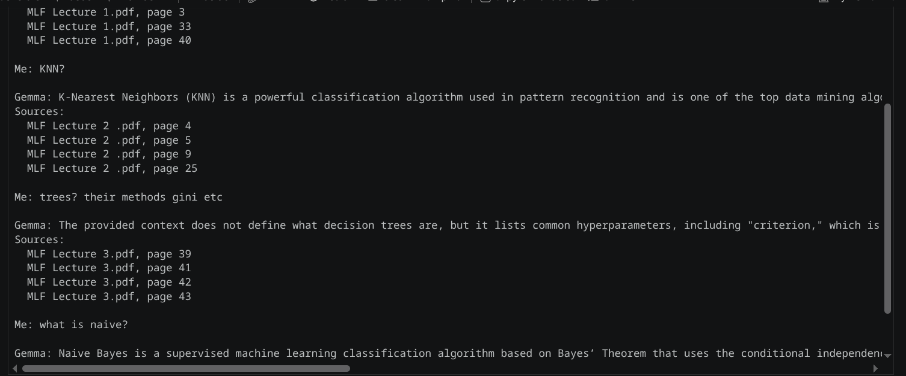

# PDF Question Answering (RAG) with LangChain, Chroma and Ollama

Ask questions about a PDF from the command line. The script splits the PDF into chunks, embeds them locally, stores them in Chroma, and uses an Ollama model to answer using only the retrieved context.

## How it works

1. **Load** the PDF with `DirectoryLoader`
2. **Split** it into overlapping chunks (`RecursiveCharacterTextSplitter`)
3. **Embed** the chunks locally with a Hugging Face model
4. **Store** the vectors in a persistent Chroma database
5. **Retrieve** the top-K most relevant chunks for each question
6. **Generate** an answer with an Ollama LLM, restricted to the retrieved context

## Requirements

- Python 3.11 or newer
- [Ollama](https://ollama.com/download) installed and running
- An Ollama model (local, or a `-cloud` model such as `gemma4:31b-cloud`)
- Internet access on first run (to download the embedding model)

## Installation

```bash
# 1. Create and activate a virtual environment
python -m venv venv

# macOS / Linux
source venv/bin/activate
# Windows
venv\Scripts\activate

# 2. Install dependencies
pip install -r requirements.txt
```

## Set up Ollama

**Option A: local model** (runs fully on your machine)

```bash
ollama pull llama3.2
```

**Option B: cloud model** (runs on Ollama's servers)

```bash
ollama signin
```

Then confirm the model is available:

```bash
ollama list
```

> **Privacy note:** with a `-cloud` model, the retrieved PDF chunks are sent to Ollama's servers as part of the prompt. Use a local model for private or sensitive documents. Embeddings and the Chroma database always stay on your machine.

## Configuration

Edit the config block at the top of the script:

```python
PDF_PATH = "./data"                            # your Dir to files/pdfs
EMBED_MODEL = "sentence-transformers/all-MiniLM-L6-v2"
LLM_MODEL = "gemma4:31b-cloud"                       # must have it otherwise it wont work 
CHROMA_DIR = "./chroma_db"
CHUNK_SIZE = 1000
CHUNK_OVERLAP = 150
TOP_K = 4
```

Make sure the script uses the config values:

```python
docs = DirectoryLoader(PDF_PATH, glob="**/*.pdf", loader_cls=PyPDFLoader, show_progress=True).load()
embeddings = HuggingFaceEmbeddings(model_name=EMBED_MODEL)
```

| Setting | What it does |
|---|---|
| `PDF_PATH` | Path to the PDF you want to query |
| `EMBED_MODEL` | Hugging Face model used to create embeddings |
| `LLM_MODEL` | Ollama model used to write answers |
| `CHROMA_DIR` | Folder where vectors are saved |
| `CHUNK_SIZE` / `CHUNK_OVERLAP` | Chunk length and overlap, in characters |
| `TOP_K` | Number of chunks retrieved per question |

## Usage

Put your PDF in the project folder, then run:


Ask a question (or 'quit'): What is the vacation policy?

Answer: 



Type `quit`, `exit` or `q` to stop.

## Recommended embedding models

| Model | Notes |
|---|---|
| `sentence-transformers/all-MiniLM-L6-v2` | Small, fast, good default for English |
| `BAAI/bge-small-en-v1.5` | Similar size, often better retrieval |
| `BAAI/bge-base-en-v1.5` | More accurate, slower |
| `BAAI/bge-m3` | Multilingual PDFs |

## Troubleshooting

**Duplicate or stale results after re-running**
`Chroma.from_documents` adds the chunks again on every run. Delete the `chroma_db` folder before re-running, or build the database once and load it afterwards:

```python
vectorstore = Chroma(persist_directory=CHROMA_DIR, embedding_function=embeddings)
```

**Changed the embedding model**
Delete `chroma_db` first. Vectors from different models are not compatible.

**`Connection refused` / cannot connect to Ollama**
Start the server with `ollama serve`, or open the Ollama app.

**`model not found`**
`LLM_MODEL` must match a name in `ollama list` exactly, including the tag (for example `gemma4:31b-cloud`).

**Auth error with a `-cloud` model**
Run `ollama signin`.

**Empty or poor answers from a scanned PDF**
`PyPDFLoader` only reads embedded text. Scanned PDFs need OCR first (for example with `ocrmypdf`).

**"I don't know" answers**
Try raising `TOP_K` (for example to 6) or `CHUNK_SIZE`, or rephrase the question using words that appear in the document.

## Project structure

```
.
├── all.ipynb        # all u need to chec is this 
├── data/            # put ur pdfs here for RAG 
├── requirements.txt
├── README.md
└── chroma_db/        # created automatically
```
